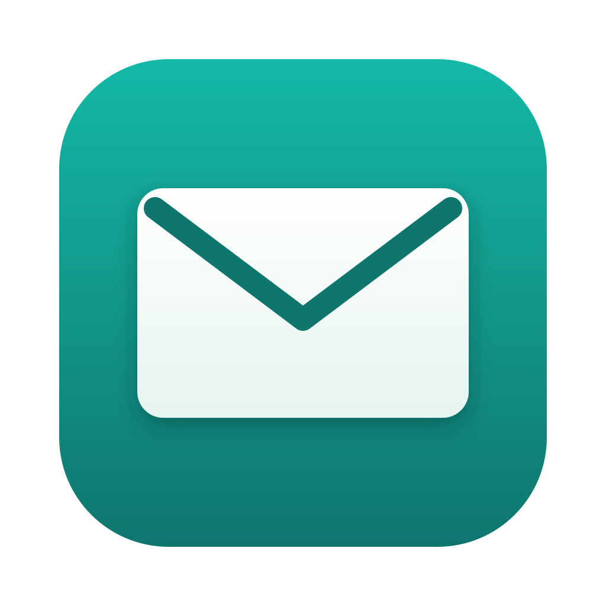

# Tern

A native macOS mail client that puts every account in one inbox. It speaks plain IMAP and SMTP, so it works with Gmail, iCloud, Zoho, Yahoo, Fastmail, AOL, GMX and any other provider that offers IMAP.

## What it does

- **Every account in one place.** A unified inbox plus each account's own folders and labels, with unread counts.
- **Add any account.** Presets for the big providers. For anything else, Tern looks up the server settings from the domain's autoconfig file or Mozilla's provider database, and falls back to `imap.domain` / `smtp.domain`.
- **Read safely.** HTML mail renders with JavaScript off and a content security policy. Images from the web stay blocked until I click **Load images**, so senders can't track opens.
- **Act fast.** Archive, trash, spam, star, read/unread and move all update the list right away and sync in the background. Failed actions roll back with a message.
- **Write and reply.** Compose windows with contact suggestions from past mail, Cc/Bcc, drag-and-drop attachments, reply, reply all and forward (forward keeps attachments). Sent mail is filed in Sent automatically, without duplicates on Gmail.
- **Search.** Typing filters downloaded mail instantly. Return searches the server (Gmail search syntax works on Gmail accounts).
- **Keyboard first.** Apple Mail shortcuts plus Gmail single-key shortcuts (`j`/`k`, `e`, `#`, `s`, `u`, `r`, `a`, `f`, `c`). Full list in Settings > Shortcuts.
- **Stays current.** Checks for mail every 5 minutes (configurable), shows notifications for new mail and an unread badge on the Dock icon.
- Passwords go to the macOS keychain. Mail is cached in `~/Library/Application Support/Tern`.

## Requirements

- macOS 14 Sonoma or newer
- Xcode 16 or newer (for building)

## Build and run

```bash
./scripts/build-app.sh
open build/Tern.app
```

The script builds a release binary, wraps it in `build/Tern.app` with the icon, and signs it ad hoc. Drag the app into `/Applications` to keep it.

For development, open `Package.swift` in Xcode and run the **Tern** scheme, or run `swift run Tern` from the terminal. Notifications only work from the bundled `.app`.

## Adding accounts

Most providers require an **app password** for mail apps instead of the normal account password. The add-account screen links straight to the right page:

| Provider | Password to use | Notes |
| --- | --- | --- |
| Gmail | App password from myaccount.google.com/apppasswords | Needs 2-Step Verification on |
| iCloud | App-specific password from account.apple.com | Sign-In and Security > App-Specific Passwords |
| Zoho Mail | Zoho password, or an app password with 2FA | Turn on IMAP in Zoho Mail settings. Pick the data center (zoho.com, .eu, .in, .com.au, .jp) and switch on "own domain" for organization accounts |
| Yahoo, AOL | App password from account security | |
| Fastmail | App password from Settings > Privacy & Security | |
| GMX | Normal password | Turn on IMAP access in GMX settings |
| Anything else | Whatever the provider says | Server settings fill in automatically when possible |

Outlook.com and Microsoft 365 aren't supported yet: Microsoft turned off password sign-in for IMAP and requires OAuth.

## Project layout

```
Sources/MailEngine/    IMAP, SMTP, MIME parsing, message building, sync. Foundation only.
  IMAP/                IMAPClient (commands, literals, LITERAL+, MOVE/UIDPLUS fallbacks), modified UTF-7
  SMTP/                SMTPClient (STARTTLS, AUTH PLAIN/LOGIN, dot-stuffing), MessageBuilder
  MIME/                Headers, RFC 2047/2231 decoding, multipart parser, charsets, dates, addresses
  Accounts/            Provider presets, Zoho regions, autoconfig lookup
  Sync/                AccountSession: two connections per account, incremental sync, actions, send
Sources/Tern/      The SwiftUI app
  Platform/            URLSessionStreamTask transport (TLS and STARTTLS), keychain, notifications
  Store/               On-disk cache of folders, message lists and bodies
  Model/               AppModel: state, optimistic actions, compose and send
  Views/               Sidebar, message list, reader, compose, add account, settings
Tests/MailEngineTests/ Parser and protocol tests, plus a full sync test against a real IMAP server
```

## Tests

MailEngine has no Apple-only dependencies, so its tests also run on Linux:

```bash
swift test
```

`IMAPIntegrationTests` talks to a Dovecot server on `127.0.0.1:10143` (user `tester@example.com`, password `secret pa"ss`) and skips itself when nothing is listening. It covers first sync, paging older mail, flag changes, new arrivals, moves, server search with non-ASCII text, permanent delete and reconnecting after a dropped connection.

## Not built yet

- Microsoft (Outlook.com, Microsoft 365) and Gmail OAuth sign-in
- Conversation threading
- Saving drafts to the server, and editing existing drafts
- Rich text compose (messages go out as plain text)
- IMAP IDLE push; new mail arrives on the polling interval
